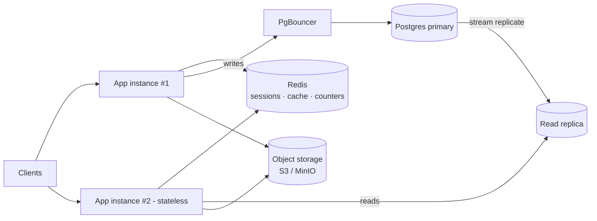

# L1 — Architecture

## From one box to a replaceable tier

You can run **two or more identical instances** now. (Putting a load balancer in front of many is L3;
here we just prove the app is stateless — run two on different ports and confirm either serves any user.)

## What moved, and why

| State (was, at L0) | Now lives in | Why |
|---|---|---|
| Session rows in Postgres, looked up per request | **Redis** (`sess:{id}`) | sub-ms lookups on the hot auth path; any instance validates any request |
| Uploaded files on local disk (never did this — good) | **Object storage** | local disk dies with the box; presigned URLs offload the app |
| Hot reads hitting Postgres every time | **Redis cache-aside** | conversation lists & tails are read constantly |
| Sync cache/index updates inside the request | **event → consumer** | avoid the dual-write trap; single source of truth = DB |

## Read vs. write paths

- **Writes** (send message, create conversation, auth mutations) → **primary** via PgBouncer.
- **Reads** (history, conversation list) → **cache first**, then **read replica** on a miss.
- **Read-your-writes:** right after a user writes, route *their* next reads to the primary (or serve from
  cache) so replication lag never shows them stale data. See `04-postgres-scaling.md`.

## The stateless checklist (enforced)

- [ ] No module-level mutable state that matters across requests.
- [ ] Sessions in Redis, not memory.
- [ ] Files in object storage, not disk.
- [ ] Config from env only; instances are byte-identical.
- [ ] Graceful shutdown drains in-flight and closes Redis + both pools.
- [ ] `/ready` checks Postgres **and** Redis.

## Degradation policy (new at L1)

Redis is an **accelerator, not the source of truth**. If Redis is down:
- **Cache reads** fall back to Postgres (slower, still correct) — *fail open*.
- **Sessions**: decide explicitly — either fail-open to a short DB fallback, or fail-closed (require
  re-login). We choose a **DB session fallback table** kept in sync so a Redis outage doesn't log
  everyone out. (Documented in `02-state-externalization.md`.)
- **Rate-limit counters**: fail-open (allow) rather than block all traffic on a cache outage.
