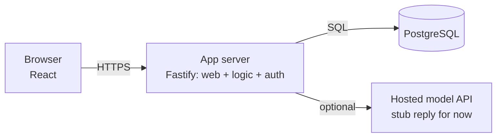

# L0 — The Monolith

> **Goal:** a working chat product on a single box. One process serves the web app, business logic,
> and talks to a co-located database.
> **Builds on:** nothing. **Unlocks:** a shippable v1.

The point of L0 is not to be scalable. It is to be **correct and complete** — to lock in the data
model and API contract that every later level must preserve. Get the schema right here and it barely
changes through L7.

---

## 1. Objective & scope

- A user can sign up / log in.
- A user can create a conversation, send a message, and receive a reply (stub or a single hosted-model
  API call — real GPU serving comes at L6).
- Messages persist and reload in order.

Out of scope: real-time streaming (L2), multiple servers (L3), scale (L4+).

## 2. Prerequisites

- One VM or container host. One Postgres instance (can be on the same box).
- A domain + TLS (use a managed cert / reverse proxy like Caddy or Nginx).

## 3. Target architecture



## 4. Tech stack (this level)

- **Frontend:** Next.js (React + TS).
- **Backend:** Node.js + Fastify (single service).
- **DB:** PostgreSQL.
- **Auth:** email/password or OAuth via a library (e.g. Lucia / Auth.js); issue a signed session cookie.

## 5. Data model (get this right — it survives forever)

```sql
CREATE TABLE users (
  id            UUID PRIMARY KEY DEFAULT gen_random_uuid(),
  email         TEXT UNIQUE NOT NULL,
  password_hash TEXT,                 -- or external identity id
  created_at    TIMESTAMPTZ NOT NULL DEFAULT now()
);

CREATE TABLE conversations (
  id         UUID PRIMARY KEY DEFAULT gen_random_uuid(),
  owner_id   UUID NOT NULL REFERENCES users(id),
  title      TEXT,
  created_at TIMESTAMPTZ NOT NULL DEFAULT now()
);

CREATE TABLE messages (
  id              UUID PRIMARY KEY DEFAULT gen_random_uuid(),
  conversation_id UUID NOT NULL REFERENCES conversations(id),
  seq             BIGINT NOT NULL,          -- monotonic per conversation: THE key decision
  author         TEXT NOT NULL,            -- 'user' | 'assistant'
  content         TEXT NOT NULL,
  created_at      TIMESTAMPTZ NOT NULL DEFAULT now(),
  UNIQUE (conversation_id, seq)            -- ordering + "give me everything after seq N"
);
CREATE INDEX ON messages (conversation_id, seq);
```

> **Why `seq` matters:** wall-clock timestamps skew across servers. A per-conversation monotonic
> sequence gives stable ordering, cursor pagination, multi-device sync ("send me messages after N"),
> and later becomes the anchor for read receipts and conflict resolution. Add it now even though you
> don't need it yet.

## 6. Build tasks

- [ ] Scaffold Next.js frontend + Fastify backend in one repo.
- [ ] Implement auth: signup, login, session cookie, `requireUser` middleware.
- [ ] Migrations for the schema above (use `drizzle`/`prisma`/`knex`).
- [ ] API: `POST /conversations`, `GET /conversations`, `GET /conversations/:id/messages?afterSeq=`,
      `POST /conversations/:id/messages`.
- [ ] On message send: allocate `seq = max(seq)+1` for that conversation (in a transaction), persist,
      then produce a reply (stub, or one hosted-model call) and persist it too.
- [ ] Frontend: conversation list, message thread, composer.
- [ ] Reverse proxy + TLS; run under a process manager (systemd / pm2 / a container).
- [ ] Structured logging + a `/health` endpoint from day one.

## 7. Key configuration

- Connection pooling to Postgres (built into the client or PgBouncer) — even one box benefits.
- Add DB indexes before you have data, not after.
- Set request timeouts and a body-size limit.

## 8. Acceptance criteria

- Two browsers, same account: a message sent in one appears in the other **after refresh**.
- Restarting the app process loses **no** persisted messages.
- `GET messages?afterSeq=N` returns exactly the messages after N, in order.
- p99 API latency `< 200ms` at ~100 req/s on the target box (measure it, don't assume).

## 9. Measurement for this level

```bash
# loadtests/l0.js  — basic CRUD ramp with k6
k6 run --vus 50 --duration 2m loadtests/l0.js
```
Watch: API p99, Postgres CPU, error rate. Record the RPS where p99 crosses 200ms — that's your L0 ceiling.

## 10. ▶ Exit trigger → L1

Advance when **either** is true:
- You can no longer accept downtime for deploys/restarts, **or**
- The single box is the bottleneck (CPU/RAM/connections maxed under real traffic).

## 11. Risks & gotchas

- **Don't** put uploaded files on local disk — even here, use object storage, or you'll rewrite it at L1.
- **Don't** hold sessions in process memory — use a signed cookie or a session row, so L1 is a small step.
- Allocating `seq` with `max()+1` needs a transaction or a per-conversation counter to avoid gaps/races.
