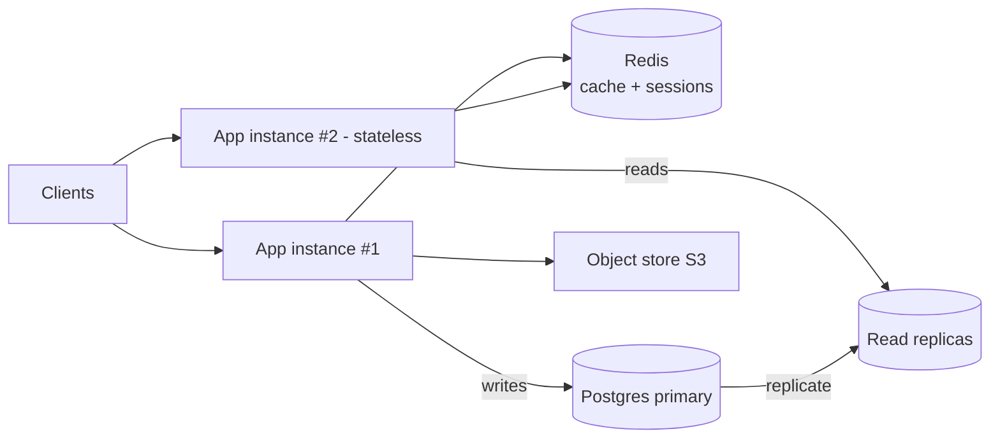

# L1 — Stateless App + Real Data Tier

> **Goal:** make one server *replaceable*. Separate the stateless app tier from stateful data, push
> all state out of process, and add read scaling.
> **Builds on:** L0. **Unlocks:** high availability and zero-downtime deploys.

The first real architectural move is **not** adding servers — it's making a server disposable so it
can die or deploy without losing anything.

---

## 1. Objective & scope

- Any app instance can serve any request; killing one loses nothing.
- Reads scale via replicas + cache; writes still go to one primary.
- Files live in object storage; sessions live in a signed token or shared store.

Out of scope: real-time push (L2), many concurrent app servers behind an LB (L3 — you *can* run 2 here,
but the LB story is L3), sharding (L5).

## 2. Prerequisites

- L0 complete: schema with `seq`, working auth, `/health`.
- Managed Postgres that supports read replicas, or the ability to add one.
- A Redis instance and an object store (S3 / MinIO).

## 3. Target architecture



## 4. Tech stack additions

- **Redis** — cache-aside, session store (if not using stateless JWTs), rate-limit counters.
- **Object storage** — presigned upload/download URLs; never proxy large files through the app.
- **Read replicas** — driver-level or proxy-level read/write splitting.

## 5. Data / state changes

- Move any local-disk artifacts to object storage; store only the object key in Postgres.
- Decide the **session model**:
  - *Stateless:* short-lived signed JWT access token + revocable refresh token in Redis/DB.
  - *Stateful:* session id cookie → session row in Redis.
- Add a cache key scheme, e.g. `conv:{id}:messages:tail` (last N messages), `user:{id}:convs`.

## 6. Build tasks

- [ ] Extract config to env/secret manager; no secrets in code.
- [ ] Make the app **12-factor**: no local state, graceful shutdown on SIGTERM, fast `/health` + `/ready`.
- [ ] Introduce Redis; implement **cache-aside** for conversation tails and lists.
- [ ] Add a **read replica**; route read-only queries to it.
- [ ] Implement **read-your-writes**: after a user writes, pin their next reads to the primary for a few
      seconds (or read from cache) to hide replication lag.
- [ ] Switch file uploads to **presigned URLs** direct to object storage.
- [ ] Add PgBouncer (transaction pooling) in front of Postgres.
- [ ] Emit Prometheus metrics: request rate, error rate, latency histogram, cache hit ratio.

## 7. Key configuration

```yaml
# cache-aside pseudo-policy
read:  try Redis -> on miss, read DB -> set Redis (TTL 60s)
write: write DB (source of truth) -> invalidate/refresh the affected keys
```

> **Gotcha — the dual-write trap:** writing to DB *and* cache/search in the same request is a hidden
> distributed transaction. Prefer: write DB, then propagate asynchronously (emit an event; a consumer
> updates cache/search). You don't need Kafka yet, but design the write path so adding it at L4 is easy.

## 8. Acceptance criteria

- Kill any app instance mid-traffic → **zero** lost messages, users just retry/reconnect.
- Deploy a new version with **zero downtime** (start new, drain old).
- Cache hit ratio on conversation reads `> 80%` under normal browsing.
- Replication lag never shows a user their own just-sent message as missing (read-your-writes works).
- Read throughput scales when you add a replica (measure before/after).

## 9. Measurement for this level

```bash
k6 run loadtests/l1.js   # heavier read mix; assert p99 < 200ms and cache hit ratio in Grafana
```
- Grafana panels: request RED metrics, cache hit ratio, replica lag, primary write CPU.
- Find the **write ceiling**: ramp writes until primary CPU or lock contention spikes — record it.

## 10. ▶ Exit trigger → L2

Advance when you need the server to **push**: stream an LLM answer token-by-token, or deliver a message
the instant it exists rather than on refresh.

## 11. Risks & gotchas

- Replication lag surprises: default async replicas can be seconds behind under load.
- Cache invalidation correctness — prefer short TTLs + event-driven refresh over clever manual invalidation.
- JWT revocation: access tokens can't be un-issued — keep them short-lived and revoke via the refresh token.
