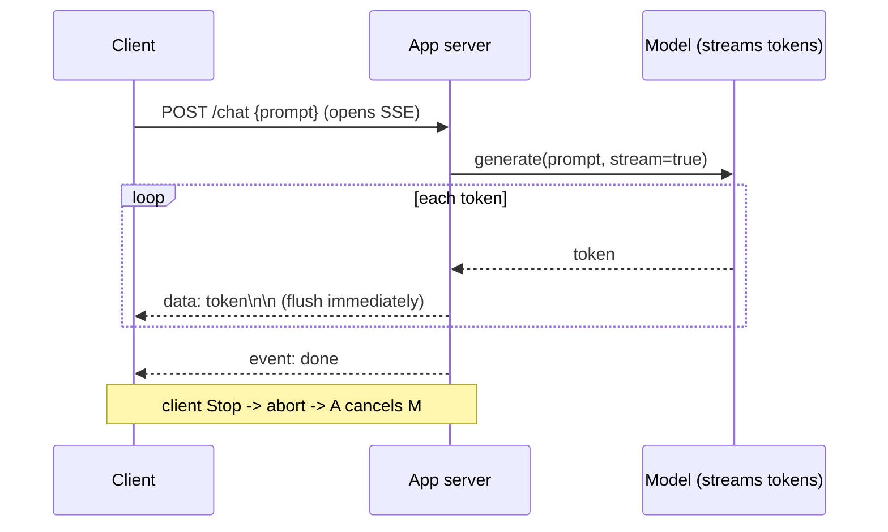

# L2 — Real-time Transport (SSE token streaming)

> **Goal:** the server pushes. Stream an answer token-by-token over SSE, with cancellation and
> reconnection done right.
> **Builds on:** L1. **Unlocks:** real-time, ChatGPT-style streaming responses.

This is the defining UX moment of an AI chat product: words appearing as they're generated instead of
a spinner. For human↔AI, **SSE** is the right default (one long-lived HTTP stream, server→client).
WebSockets come at L4 when you need bidirectional/social features.

---

## 1. Objective & scope

- `POST /chat` accepts a prompt and returns an **SSE stream** of tokens.
- User can **stop** generation; the stop propagates to free the upstream/model.
- A dropped connection can **resume** rather than restart the (expensive) generation.

Out of scope: multiple connection servers (L3), cross-server delivery (L4).

## 2. Prerequisites

- L1 complete: stateless app, Redis, metrics.
- A model source: a hosted LLM API that streams, or a local model. (Full GPU serving = L6.)

## 3. Target architecture



## 4. Tech stack notes

- SSE needs no new infra — it's plain HTTP. Ensure your proxy does **not buffer** the response.
- Persist the assistant message incrementally or at end-of-stream (with the `seq` from L0).

## 5. Data / protocol

- SSE frames: `data: <token>\n\n`; a final `event: done\ndata: {usage}\n\n`.
- Include a **stream/message id** and support `Last-Event-ID` for resume.
- Store partial output keyed by message id in Redis so a resume can replay what was already sent.

## 6. Build tasks

- [ ] Implement `POST /chat` returning `Content-Type: text/event-stream`, `Cache-Control: no-cache`,
      `Connection: keep-alive`.
- [ ] Stream model tokens through to the client and **flush after each** token/chunk.
- [ ] Send a heartbeat comment (`: ping\n\n`) every ~15s to keep intermediaries from killing idle streams.
- [ ] Wire **cancellation**: on client `AbortController`/disconnect, cancel the upstream model call.
- [ ] Persist the assistant message (final content, token usage) at stream end; on cancel, persist partial + a `cancelled` flag.
- [ ] Emit **TTFT** (request start → first token) and **ITL** (inter-token gap) as Prometheus histograms.
- [ ] Frontend: consume the stream with `fetch` + `ReadableStream` (or `EventSource`), append tokens live,
      show a Stop button that aborts.

## 7. Key configuration

```nginx
# Nginx in front of the app: DO NOT buffer SSE
location /chat {
  proxy_pass http://app;
  proxy_buffering off;
  proxy_read_timeout 3600s;
  proxy_set_header Connection '';
  chunked_transfer_encoding on;
}
```
```bash
# raise OS limits on the box that holds streams
ulimit -n 1048576              # file descriptors
# /etc/sysctl.conf: net.ipv4.ip_local_port_range, net.core.somaxconn, tcp_max_syn_backlog
```

## 8. Acceptance criteria

- First token reaches the browser in **TTFT p95 < 800ms** (with a fast model/stub).
- Tokens render smoothly: **ITL p95 < 80ms**, no clumping (proves buffering is off).
- Hitting **Stop** stops token billing/generation within ~1s (verify upstream cancel).
- Killing the network mid-stream and reconnecting **resumes** without restarting generation.

## 9. Measurement for this level

```bash
k6 run loadtests/l2-sse.js   # xk6-sse: ramp concurrent streams, assert ttft_ms p95<800
```
- Ramp concurrent streams until TTFT degrades or fds/CPU saturate → that's this single box's stream ceiling.
- Watch: active streams gauge, TTFT/ITL histograms, fd count, CPU.

## 10. ▶ Exit trigger → L3

Advance when **one box can't hold the number of concurrent streams/connections** you need — you must
spread them across a fleet.

## 11. Risks & gotchas

- Buffering anywhere (proxy, framework, CDN) silently ruins streaming — test end-to-end, not just locally.
- Un-cancelled streams are pure wasted money at L6; get cancellation right *now* while it's cheap.
- Long-lived streams change deploy behavior — a naive restart drops them all (L3 solves draining).
- Make generation **idempotent by message id** so a resume/retry never double-posts or double-bills.
