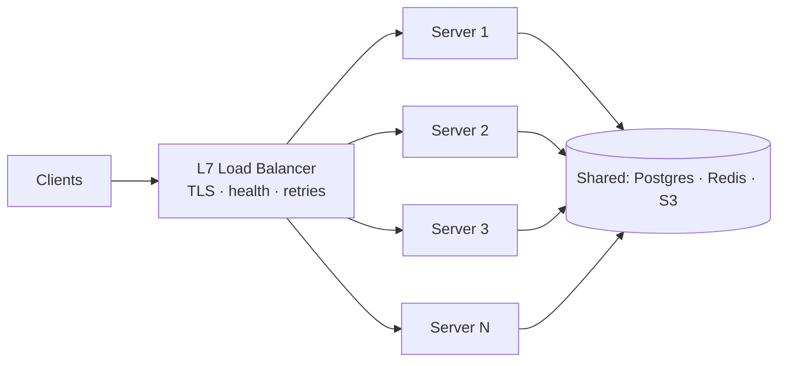

# L3 — Horizontal Scale & Load Balancing

> **Goal:** run many identical stateless servers behind one address, and handle persistent connections
> correctly across the fleet.
> **Builds on:** L2. **Unlocks:** horizontal scale — capacity grows by adding boxes.

Simple in principle, but persistent connections (SSE/WebSocket) break assumptions that normal
request/response load balancing takes for granted.

---

## 1. Objective & scope

- N stateless app/connection servers behind an L7 (and/or L4) load balancer.
- Connections spread evenly; deploys don't cause mass disconnects.
- Autoscaling on the right signal (connection count, not just CPU).

Out of scope: delivering a message from a socket on server A to a socket on server B — that's the
**fan-out problem**, solved at L4. At L3, cross-server delivery still doesn't work.

## 2. Prerequisites

- L2 complete: streaming works on one box, OS limits tuned, graceful shutdown implemented.
- A container platform (Kubernetes) or an autoscaling group + a load balancer.

## 3. Target architecture



## 4. Tech stack additions

- **Load balancer:** cloud L7 LB (ALB / GCLB) or Nginx/Envoy; L4 NLB for raw WebSocket throughput.
- **Kubernetes:** Deployment + Service + HPA; readiness/liveness probes; `preStop` drain hook.
- Split the **connection tier** out as its own service if socket handling competes with API work
  (Go is a strong choice for holding many sockets cheaply).

## 5. Config / operational model

- **Algorithm:** least-connections (not round-robin) for long-lived sockets, so a busy box doesn't keep
  getting new connections.
- **Connection draining:** on deploy, stop accepting new connections, let existing ones finish or ask
  clients to reconnect, then terminate.
- **Client reconnect:** exponential backoff **with jitter** to avoid a thundering herd on redeploy.

## 6. Build tasks

- [ ] Containerize each service; pin resource requests/limits.
- [ ] Put the fleet behind an L7 LB; terminate TLS at the LB.
- [ ] Configure **least-connections** (or equivalent) balancing for the streaming/socket path.
- [ ] Implement graceful shutdown: `SIGTERM` → stop new work → drain (respect `terminationGracePeriodSeconds`).
- [ ] Add readiness gating so the LB only routes to `ready` pods.
- [ ] HPA: scale connection servers on **open-connections** and CPU; scale API on RPS/CPU.
- [ ] Client: reconnect with jittered backoff + resume (from L2's `Last-Event-ID`).
- [ ] Load-balance-aware metrics: connections per pod, LB 5xx, drain events.

## 7. Key configuration

```yaml
# k8s: give sockets time to drain on rollout
terminationGracePeriodSeconds: 120
lifecycle:
  preStop: { exec: { command: ["/bin/sh","-c","sleep 90"] } }  # stop new, let old finish
readinessProbe: { httpGet: { path: /ready, port: 8080 }, periodSeconds: 5 }
```
```
# rollout strategy: never drop everything at once
strategy: RollingUpdate  (maxUnavailable: 0, maxSurge: 25%)
```

## 8. Acceptance criteria

- Connections spread **evenly** across pods (skew < ~15%) under sustained load.
- A rolling deploy causes **no error spike**; disconnected clients reconnect and resume seamlessly.
- Killing a pod: only its connections blip and reconnect elsewhere; no data loss.
- Total concurrent connections scale ~linearly as you add pods (measure it).

## 9. Measurement for this level

```bash
k6 run loadtests/l3-ws.js   # open & hold N connections, then trigger a rolling deploy mid-test
```
- Assert: even connections/pod, zero message loss across a deploy, reconnect success ~100%.
- Ceiling test: add connections until pods hit their socket/mem limit → capacity per pod × pods.

## 10. ▶ Exit trigger → L4

Advance the moment you need **cross-server delivery**: group chat, multi-device sync, presence, or an
AI response that must reach a user whose socket is on a different server than the one that started it.

## 11. Risks & gotchas

- **Sticky sessions are a trap** — they make caching easy but deploys/failover painful. Keep servers
  stateless and solve routing with a registry (L4), not stickiness.
- A rollout with `maxUnavailable > 0` on the connection tier = mass disconnects. Use surge + drain.
- Idle-timeout mismatches between LB and app silently kill long streams — align them (and heartbeat).
