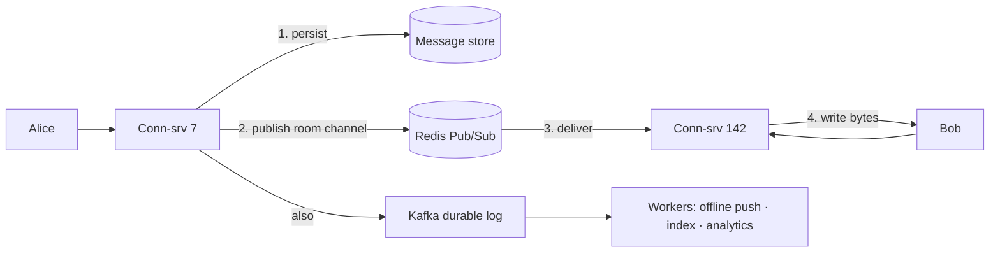

# L4 — The Fan-out Problem (pub/sub backbone)

> **Goal:** deliver a message to the right socket when connections are spread across many servers.
> **Builds on:** L3. **Unlocks:** real multi-user chat, multi-device sync, presence.

Alice's socket is on server 7; Bob's is on server 142. Server 7 received Alice's message but has no
connection to Bob. Crossing that gap, at millions of connections, is the core of every real-time chat
backend.

---

## 1. Objective & scope

- Split into a **connection tier** (holds sockets) + a **pub/sub backbone** (crosses servers).
- Online users get sub-ms delivery; offline users get messages on reconnect via `seq` sync.
- Presence (online/typing) without melting the system.

Out of scope: sharding the primary DB (L5), AI generation (L6).

## 2. Prerequisites

- L3 complete: connection tier deployed, draining + reconnect working.
- Redis (pub/sub + presence), and a durable log (Kafka) for offline/async paths.

## 3. Target architecture



## 4. Tech stack additions

- **Redis Pub/Sub** — live fan-out to online sockets (at-most-once, sub-ms). Loses messages if a
  consumer is momentarily down — that's fine because the DB is the source of truth.
- **Kafka** — durable, replayable pipeline for offline delivery, push notifications, search indexing,
  analytics, CDC.
- **Connection registry** in Redis: `user:{id} -> conn-server`, refreshed by heartbeat with a TTL.

## 5. Delivery model (the hybrid that real systems use)

```
on send:
  1. assign seq (per conversation)         # ordering
  2. persist to message store              # DURABILITY FIRST — never lose a sent message
  3. publish to channel room:{id} (Redis)  # instant delivery to online members
  4. append to Kafka topic                 # offline delivery, push, indexing, analytics
on reconnect:
  client asks GET messages?afterSeq=N      # catch up anything missed while offline
```

## 6. Build tasks

- [ ] Extract the connection tier; each server subscribes to the Redis channels for the rooms its
      sockets are in, and keeps a **local** map `room -> {local socket ids}`.
- [ ] Implement the send path: persist → publish → Kafka append (in that order).
- [ ] On receiving a published message, each connection server writes only to its **local** matching sockets.
- [ ] **Re-authorize on delivery:** verify the recipient is a member of the room before writing — never
      assume subscription implies permission.
- [ ] At-least-once + **dedup by message id** on the client so retries don't duplicate.
- [ ] Presence: `SET user:{id}:online EX 30` on heartbeat; publish presence changes **debounced**; never
      persist typing indicators.
- [ ] Kafka consumers: offline push notifications, search indexer, analytics.
- [ ] Metrics: publish→deliver lag, delivery rate vs send rate, channel skew, presence write rate.

## 7. Key configuration

```
# Channel sharding for hot rooms: split a huge room across sub-channels
room:{id}:shard:{0..K}   # producers hash by member; consumers subscribe to their shard
```
> **Redis Pub/Sub vs Kafka:** Pub/Sub = fire-and-forget, sub-ms, for *live* delivery. Kafka = durable,
> replayable, for *guaranteed* async work. Use **both**, not one.

## 8. Acceptance criteria

- Message from a socket on server A reaches a socket on server B in **< 100ms p95** while online.
- Delivery rate **equals** send rate under load (no silent drops on the live path).
- A user offline during a burst receives **all** missed messages on reconnect (via `afterSeq`), in order.
- A non-member never receives a room's messages (authorization-on-delivery holds).
- Presence updates don't dominate write load (debounced; ephemeral).

## 9. Measurement for this level

```bash
k6 run loadtests/l4-fanout.js   # large rooms; assert delivery==send, measure pub->deliver lag
```
- Hot-channel test: concentrate traffic on one room → confirm channel sharding keeps lag flat.
- Watch: Redis pub/sub throughput, Kafka consumer lag, delivery/send ratio.

## 10. ▶ Exit trigger → L5

Advance when the **single primary database** can't hold the write throughput or the accumulating volume
of history (approaching its write/storage ceiling).

## 11. Risks & gotchas

- Relying on Redis Pub/Sub alone = lost messages for briefly-disconnected consumers. Always back it
  with persistence + `afterSeq` sync.
- Presence write storms: typing indicators fan out constantly — debounce and TTL, or they'll cost more
  than real messages.
- Ordering across the two paths: the `seq` from L0 is what keeps live + catch-up messages consistent.
- Dead connection servers must expire from the registry (TTL) or you'll route to nowhere.
