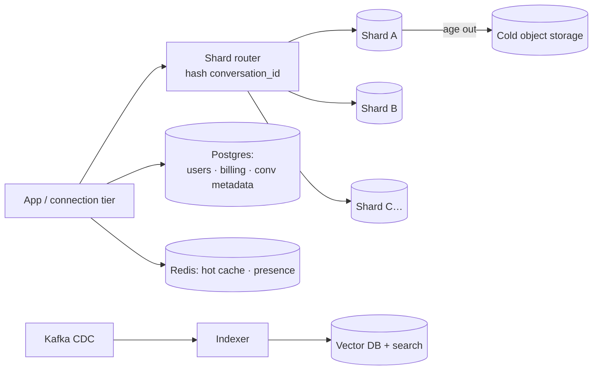

# L5 — Data at Scale (sharding + polyglot persistence)

> **Goal:** store petabytes of history and absorb ~1 GB/s of writes by sharding, and use the right store
> for each data shape.
> **Builds on:** L4. **Unlocks:** message history that scales without a ceiling.

At this volume a single primary is impossible. *How* you shard decides which queries stay fast and which
become distributed nightmares — so pick the shard key from the access pattern, not the data.

---

## 1. Objective & scope

- Migrate messages to a horizontally-scalable store, sharded by **conversation_id**.
- Adopt polyglot persistence: relational for entities, wide-column for messages, Redis for hot data,
  vector/search for retrieval.
- Tier hot→cold; feed retrieval (RAG) for the AI layer.

Out of scope: GPU inference (L6), multi-region (L7).

## 2. Prerequisites

- L4 complete: hybrid delivery (persist → pub/sub → Kafka), `seq` ordering solid.
- A wide-column store (Cassandra/ScyllaDB/DynamoDB) and a vector/search store.

## 3. Target architecture



## 4. Store-by-store choices

| Data | Store | Why |
|---|---|---|
| Messages (append-heavy, time-ordered) | Cassandra / ScyllaDB / DynamoDB | linear write scaling, TTL tiering |
| Users, conversations, billing | Postgres (sharded if needed) | transactions, relations |
| Hot cache, presence, counters | Redis | sub-ms, ephemeral |
| Full-text + semantic search | OpenSearch + vector DB | history search, RAG retrieval |
| Attachments | Object storage + CDN | cheap, durable, edge-cached |
| Event pipeline | Kafka | CDC, async work, analytics |

## 5. Data model at scale

```
# Wide-column messages, partitioned so a conversation lives on one shard
partition key: conversation_id
clustering key: seq            # ordered within the partition
columns: id, author, content, created_at, meta
TTL: hot table 30–90d; older rows compacted / aged to cold store
```
- Reads: "load conversation" = single-partition scan by `seq` range → fast.
- Sharding by `conversation_id` (not `user_id`) keeps a group conversation on one shard.

## 6. Build tasks

- [ ] Introduce the message store; **dual-write + backfill** to migrate from Postgres safely
      (write both, backfill history, verify, cut reads over, stop old writes).
- [ ] Implement the shard router (client-side hashing or a proxy) keyed on `conversation_id`.
- [ ] Set up **CDC from the log** (Kafka) → search/vector indexer (avoid dual-write to the index).
- [ ] Build the **RAG path**: embed messages/docs → vector store; retrieve top-k for the AI context (used at L6).
- [ ] Implement **hot/cold tiering**: TTL + a job that ages old partitions to cold object storage; a
      read path that transparently fetches cold data when asked.
- [ ] Hot-partition defense: detect skew; sub-shard hot conversations by time window; cache in front;
      rate-limit pathological producers.
- [ ] Capacity dashboards: per-shard write rate, storage, p99 read latency, compaction.

## 7. Key configuration

```
# Sub-shard a hot conversation by time bucket to spread a single hot key
partition key: (conversation_id, day_bucket)
# consistency: tune per operation (e.g. LOCAL_QUORUM writes, ONE reads for tails)
```

## 8. Acceptance criteria

- No single shard exceeds ~2× the median shard's load under a **skewed** workload test.
- "Load conversation" stays **single-partition** and meets p99 read latency `< 50ms` from the hot tier.
- Migration is **lossless**: row counts + checksums match old vs new for all history.
- Cold reads work transparently (older-than-TTL messages still retrievable, just slower).
- Search/RAG index stays consistent with the source via CDC (no dual-write drift).

## 9. Measurement for this level

```bash
k6 run loadtests/l5-skew.js   # 80/20 hot-key workload; assert no shard saturates
```
- Watch: per-shard write/read rate, hottest-vs-median ratio, compaction backlog, cold-fetch latency.
- Ceiling test: raise write rate until one shard degrades → add shards / rebalance and re-test.

## 10. ▶ Exit trigger → L6

Advance when you add **AI generation** — the bottleneck now moves from data to GPUs, and the whole cost
profile changes.

## 11. Risks & gotchas

- **Hot partitions are inevitable** — design for skew from day one; uniform load is a myth.
- Cross-shard queries and transactions are painful — keep them out of the hot path.
- Rebalancing/resharding is an operational project — pick a store with online rebalancing, and over-shard
  a little up front (virtual nodes).
- Never dual-write DB + index in one request — derive the index from the log (CDC).
