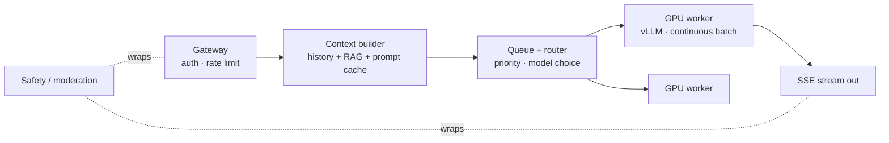

# L6 — The LLM Inference Layer

> **Goal:** serve model generation efficiently — the part that makes it ChatGPT, not Slack. GPU fleet,
> continuous batching, KV-cache management, queueing, streaming, routing.
> **Builds on:** L5. **Unlocks:** the actual product.

Serving an LLM is not like serving an API. It's running a fleet of extremely expensive, stateful,
latency-sensitive accelerators as efficiently as physics allows. This level dominates cost, latency
budget, and operational difficulty.

---

## 1. Objective & scope

- A gateway → context builder → queue/router → GPU workers → SSE stream pipeline.
- Continuous batching, paged KV cache, admission control, cancellation, model routing.
- Safety/moderation on the hot path; per-tier priority; cost accounting.

Out of scope: multi-region (L7).

## 2. Prerequisites

- L5 complete: message store, RAG/vector retrieval, Kafka.
- L2 streaming path (SSE) — reused as the output transport.
- GPU capacity (cloud GPU nodes or reserved capacity) + Kubernetes GPU scheduling.

## 3. Target architecture



## 4. Tech stack additions

- **Inference server:** vLLM (or TGI / TensorRT-LLM / SGLang) — gives continuous batching + paged KV.
- **Queue/router:** a lightweight service (or the serving framework's scheduler) with priority classes.
- **GPU telemetry:** DCGM exporter → Prometheus.
- **Moderation:** a fast small classifier model for input/output.

## 5. Request path & the two phases

```
prefill  (process whole prompt, fill KV cache) -> compute-bound  -> sets TTFT
decode   (one token at a time, autoregressive) -> mem-bandwidth  -> sets tokens/sec
```
- **KV cache** grows with context length and consumes GPU HBM — it caps concurrent requests per card.
- Consider **disaggregating** prefill and decode onto separate pools at very large scale.

## 6. Build tasks

- [ ] **Gateway:** authn/z, per-tier rate limits (RPS, **tokens/min**, concurrent generations), request id.
- [ ] **Context builder:** assemble system prompt + retrieved context (RAG from L5) + recent history,
      trimmed to a token budget; enable **prompt/prefix caching** for the stable prefix.
- [ ] **Queue + admission control:** priority by tier (paid > free); shed/slow low priority under pressure;
      expose queue depth + wait time.
- [ ] **Model routing:** cheap/small model for easy queries, flagship for hard ones; route by capability
      and version.
- [ ] **GPU workers (vLLM):** enable **continuous batching** and **paged KV**; set max model len,
      max num seqs, and quantization (FP8/INT8) as appropriate.
- [ ] **Streaming:** pipe worker tokens back through the L2 SSE path; propagate **cancellation** to the
      worker to free the batch slot instantly.
- [ ] **Reliability:** max generation timeout; idempotency by message id; retry-on-another-worker with
      partial-checkpoint or clean restart; keep old model version warm for rollback.
- [ ] **Safety:** moderate input and output; block/flag; keep it fast (small model) since it's on the hot path.
- [ ] **Cost accounting:** record input/output tokens per request; export cost per conversation / per user.

## 7. Key configuration

```python
# vLLM worker (illustrative)
LLM(model=MODEL, tensor_parallel_size=N,
    gpu_memory_utilization=0.90,   # leave headroom for KV cache
    max_num_seqs=256,              # concurrent sequences (batch width)
    quantization="fp8",
    enable_prefix_caching=True)    # reuse KV for shared prefixes
```
```
# Autoscaling reality: GPUs are slow to acquire and cold-load models (minutes).
# => provision to forecast + buffer; let the QUEUE absorb spikes, not per-request scale-up.
```

## 8. Acceptance criteria

- **TTFT p95 < 800ms** and **ITL p95 < 80ms** at target concurrency.
- Continuous batching lifts throughput several-fold vs naive one-at-a-time (measure both).
- A client **Stop** frees the GPU slot within ~1s (batch slot returns; tokens/sec for others recovers).
- Under a spike, the queue absorbs load: paid tier holds SLO, free tier degrades gracefully (no crash).
- Model routing measurably lowers cost/conversation with no quality regression on the eval set.
- Prompt caching reduces prefill cost for repeated prefixes (measure cache hit + TTFT delta).

## 9. Measurement for this level

```bash
genai-perf profile -m MODEL --concurrency 1 8 32 128   # TTFT, ITL, tokens/s vs concurrency
k6 run loadtests/l6-spike.js                            # 10x spike; assert paid-tier SLO holds
```
- Dashboards: GPU util, KV/HBM usage, queue depth & wait, tokens/s per GPU, cost per conversation.
- Find the **knee**: raise concurrency until TTFT hockey-sticks → that's capacity per pool
  (cross-check with Little's Law: concurrent = arrival_rate × time_in_system).

## 10. ▶ Exit trigger → L7

Advance when users are **globally distributed** and latency + data-residency law demand compute closer
to them.

## 11. Risks & gotchas

- **GPU cost is ~90% of infra** — every lever here (batching, paging, quantization, routing, caching) is
  a cost decision, not a nicety.
- You **cannot** autoscale GPUs per-request like web servers — the queue is your shock absorber.
- Un-cancelled/abandoned streams waste the scarcest resource you have — enforce timeouts + propagate cancels.
- Prompt injection: user + retrieved content becomes model input — treat as untrusted; never let output
  trigger privileged actions without an auth gate.
- KV cache OOM under long contexts — bound max context and monitor HBM headroom.
