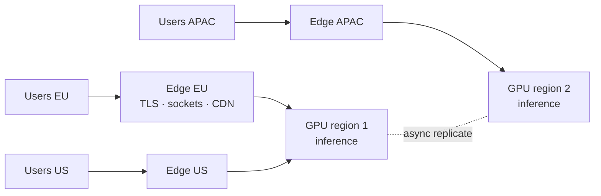

# L7 — Going Global (multi-region + edge)

> **Goal:** low-latency access worldwide, regional data residency, and survival of a full region loss.
> **Builds on:** L6. **Unlocks:** a product that feels local everywhere.

You can't out-engineer the speed of light: Sydney↔Virginia is ~200ms round-trip before any work. Global
scale means putting compute near users, which reintroduces the hardest problem — cross-region consistency.

---

## 1. Objective & scope

- Edge presence for connections, TLS, and static/media (CDN).
- Inference concentrated in a few **GPU super-regions** (capacity is scarce and uneven globally).
- A chosen data topology honoring latency **and** compliance.
- Regional failover.

Out of scope: this is the top of the ladder — beyond here is refinement (cost, quality, efficiency).

## 2. Prerequisites

- L6 complete: inference pipeline with queue, routing, batching, cost accounting.
- Multi-region infra (Terraform), a global load balancer / anycast, a CDN.

## 3. Target architecture



## 4. Tech stack additions

- **Global routing:** anycast / GeoDNS / global LB to send users to the nearest edge.
- **CDN:** all static assets and media, always (cheapest, biggest win).
- **Edge compute:** terminate TLS + hold sockets regionally; backhaul over warm internal links.
- **Cross-region replication:** async for message stores; explicit conflict handling where needed.

## 5. Data topology — pick one (each a point on the consistency/latency triangle)

| Topology | Idea | Cost |
|---|---|---|
| Single-region primary | all writes go home; regions cache reads | simple; far users have slow writes |
| Data residency by user | each user's data lives in their home region | fast for them; cross-region chats complex |
| Active-active multi-master | writes anywhere, reconcile | fastest; hardest correctness |

> **For an LLM product, geography follows the GPUs:** connections + light state at the edge, inference in
> a few GPU super-regions. Data-residency law (GDPR, etc.) often *forces* the topology more than perf does.

## 6. Build tasks

- [ ] Put static + media behind a **CDN**; verify cache hit ratios.
- [ ] Deploy **edge/regional** connection tiers; route users to nearest via global LB/anycast.
- [ ] Choose and implement the **data topology** (start with per-user residency or single-primary).
- [ ] Route inference requests to the **nearest GPU region**, with overflow/failover to another.
- [ ] Implement **async cross-region replication** for the message store; define conflict resolution
      (last-write-wins by `seq`/timestamp, or CRDT-style where needed).
- [ ] **Data residency controls:** tag users/data with a region; enforce that data stays in-region.
- [ ] **Regional failover** runbook + automation: detect region loss, reroute traffic, degrade gracefully.
- [ ] Keep cross-region **egress** down: keep chatty traffic intra-region; replicate in batches.

## 7. Key configuration

```
# routing intent
user -> nearest edge (anycast)        # short-hop connection
edge -> nearest healthy GPU region    # accept some latency to reach the model
writes -> per residency rule          # home region or single primary
replication -> async, batched, monitored for lag
```

## 8. Acceptance criteria

- p95 connection/TTFT latency meets target **in every served region** (not just the home region).
- Killing an entire region (game day) reroutes traffic with SLOs still met; **no data loss** for
  committed messages.
- Data-residency: a EU user's messages are provably stored in-region.
- Cross-region replication lag stays within its SLO; conflicts resolve deterministically.
- Egress cost per conversation stays within budget (no accidental cross-region chatter).

## 9. Measurement for this level

```bash
k6 cloud run loadtests/l7-geo.js     # drive load from multiple geographies at once
# then, mid-test:
kubectl ... / chaos-mesh: kill an entire region and observe failover + SLO burn
```
- Dashboards: per-region latency, replication lag, failover time, cross-region egress, GPU capacity by region.

## 10. ▶ Beyond L7

There are no more levels — only refinement:
- **Cost:** deeper routing, caching, quantization, reserved capacity, unit-economics tuning.
- **Quality:** continuous evals, better retrieval, model upgrades behind canaries.
- **Efficiency & reliability:** the full measurement discipline from Chapter 08, run forever.

## 11. Risks & gotchas

- The speed of light is non-negotiable — spend the edge latency you save on reaching the model fast.
- Active-active correctness is genuinely hard — don't reach for it unless residency/latency truly require it.
- GPU capacity is unevenly available by region — your topology is constrained by where you can *get* GPUs.
- Compliance (data residency, deletion, audit) often dictates architecture more than performance — design it in.
